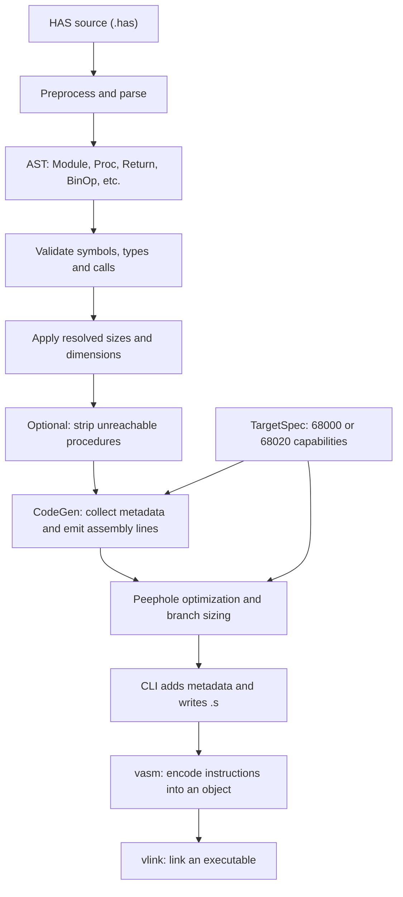
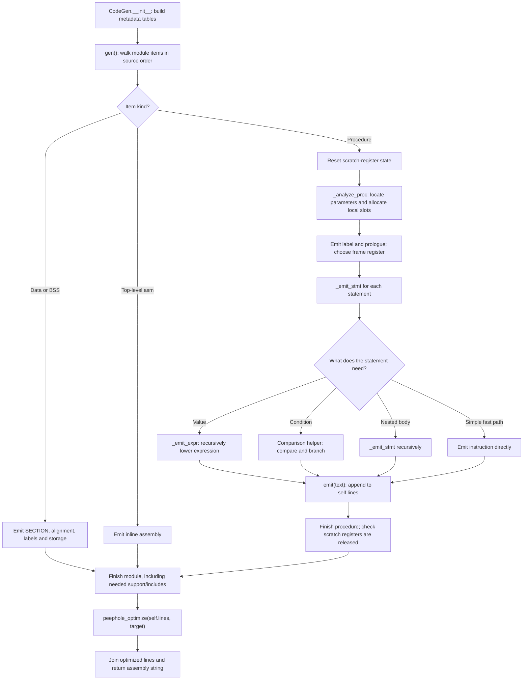
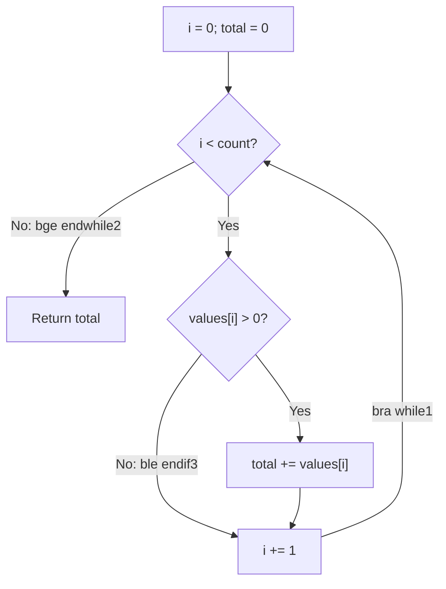

# How HAS Emits Assembly

A visual introduction to the code generator, followed by three worked examples
from a constant return to an array-processing loop.

The assembly below was generated with HAS **0.9.11** and checked with vasm on
**2026-10-28**, for both `--cpu 68000` and `--cpu 68020`. It is actual output,
not idealized hand-written assembly. Metadata and explanatory compiler comments
are omitted, and whitespace is normalized. Expected return values are explained
from the code; these examples were compiled and assembled, not run in an emulator.

## 1. The big picture

The **emitter** translates AST nodes into assembly text. An AST (abstract syntax
tree) represents the meaning and nesting of the source: a procedure contains
statements; a return statement contains an expression.



Text-only reading:

```text
.has -> preprocess/parse -> AST -> validate/resolve -> optional stripping
     -> CodeGen -> peephole optimization -> .s -> vasm -> object -> vlink
```

Mermaid diagrams render in supported Markdown previews and on GitHub. The
text-only flow above also works in a plain editor.

**Important boundary:** HAS generates assembly text, not machine-code bytes.
vasm encodes instructions; vlink resolves and links objects. Ordinary compilation
stops at the `.s` file; `--exe` requests the assembly/link steps too.

## 2. Inside the emitter

The main implementation is [hasc/codegen.py](../hasc/codegen.py).



The diagram groups repeated work: each procedure has many statements, and
`gen()` continues with the remaining module items before finishing the module.
Explicit `return` statements emit their own epilogues; when needed, `gen()`
supplies a fall-through epilogue.

### The small set of ideas to remember

| Component | What it does |
|---|---|
| `CodeGen.__init__()` | Collects procedure signatures, constants, globals, arrays, struct layouts, externs and register locks. |
| `gen()` | Emits sections and procedures, then runs the optimizer and returns assembly text. |
| `_analyze_proc()` | Computes parameter/local locations and frame size before emitting the body. |
| `_emit_stmt()` | Dispatches statements such as declarations, assignments, returns, calls, `if` and loops. |
| `_emit_expr()` | Recursively produces an instruction list for a value, usually targeting `d0`. |
| Comparison helpers | Emit direct conditional branches where possible, rather than always constructing a Boolean value first. |
| `emit(text)` | Simply appends one string to `self.lines`; it does not assemble or execute anything. |
| `peephole_optimize()` | Rewrites assembly patterns and selects branch sizes after emission. |

This is a **direct AST-to-assembly backend**, not a pipeline through a separate
SSA-style intermediate representation. Some optimizations already happen during
emission, including constant folding and specialized statement paths. The final
peephole pass is an additional stage, not the only source of optimization.

### Values, registers and memory

- `d0` is the usual expression-result and integer-return register; `d1` commonly
  holds another operand. More complex expressions may need additional temporary
  registers or stack spills.
- [RegisterAllocator](../hasc/register_allocator.py) tracks scratch-register use.
  It is reset at procedure entry and checked for unreleased temporaries at exit.
  It does **not** generally keep every source local in a register.
- Ordinary stack parameters occupy four-byte argument slots, starting at
  `8(a6)` after the callee's `link`. Local offsets are negative.
- In the examples with locals, the generator saves `a4` and uses it as a stable
  local-frame base. `a6` still establishes the frame and addresses stack parameters.
  Register locks can change the frame choice.
- Type and layout information determine load/store widths and element strides.
  The examples use 32-bit `int` values and `.l` array elements.
- Labels such as `while1` and `endif3` come from `_next_label()`. Their numbers
  depend on the order in which the module is emitted.

These are the conventions exercised below, not a complete native/register-argument
or AmigaOS ABI reference. In particular, do not infer automatic preservation of
every register from these examples.

## 3. Example 1: return a constant

**Learn:** procedure boundaries, literal emission and peephole optimization.

### HAS source

Save as `example_01.has`:

```has
code main:
    asm {
        jmp main
    }

    proc main() -> int {
        return 42;
    }
```

HAS has **no automatic `main()` call**. The first instruction in the code section
is the explicit `jmp main`. This enters the procedure without adding another
return address; its `rts` returns to the program's caller.

### How emission happens

```text
Proc main
  -> _analyze_proc: no parameters, no locals
  -> prologue: link a6,#0
  -> _emit_stmt(Return)
       -> _emit_expr(Number(42)): move.l #42,d0
       -> epilogue: unlk a6; rts
  -> peephole optimizer: move.l #42,d0 becomes moveq #42,d0
```

### Final assembly: identical for both targets

```asm
    SECTION main,code
    cnop 0,4
    jmp main

main:
    link a6,#0
    moveq #42,d0
    unlk a6
    rts
```

`link` saves the previous frame pointer and establishes a new frame; `#0` means
no local-storage allocation. `unlk` dismantles it. `moveq` can load this signed
8-bit immediate into a full 32-bit data register. **Expected result: `d0 = 42`.**

Notice that the normal, non-empty procedure still has a frame even though its
body is tiny. Do not confuse HAS's generated output with the shortest possible
hand-written routine.

## 4. Example 2: locals, arguments and addition

**Learn:** frame layout, right-to-left argument pushing, recursive expression
emission and caller stack cleanup.

### HAS source

Save as `example_02.has`:

```has
code main:
    asm {
        jmp main
    }

    proc main() -> int {
        var left: int = 10;
        var right: int = 20;
        return add(left, right);
    }

    proc add(a: int, b: int) -> int {
        return a + b;
    }
```

### How emission happens

1. `_analyze_proc(main)` assigns `left` and `right` four-byte local slots.
   The prologue reserves **12 bytes**: eight for locals and four for saved `a4`.
2. `_emit_stmt(VarDecl)` writes each numeric initializer directly to its slot.
   It need not load the constant into `d0` first.
3. `_emit_stmt(Return)` calls `_emit_expr(Call(...))`. The call path uses the
   known procedure signature, pushes `right` then `left`, and emits `jsr add`.
4. In `add`, the return expression is a `BinOp("+", VarRef("a"), VarRef("b"))`.
   `_emit_expr()` loads the operands and adds them, leaving the sum in `d0`.
5. After the call, the caller removes eight argument bytes and returns the
   existing result in `d0`.

### Final assembly: identical for both targets

```asm
    SECTION main,code
    cnop 0,4
    jmp main

main:
    link a6,#-12
    move.l a4,-12(a6)
    move.l a6,a4
    move.l #10,-4(a4)
    move.l #20,-8(a4)
    move.l -8(a4),-(a7)
    move.l -4(a4),-(a7)
    jsr add
    addq.l #8,a7
    move.l -12(a6),a4
    unlk a6
    rts

add:
    link a6,#0
    move.l 8(a6),d0
    move.l 12(a6),d1
    add.l d1,d0
    unlk a6
    rts
```

Immediately after `add` establishes its frame:

```text
Higher addresses
  12(a6)  b = 20       pushed first by caller
   8(a6)  a = 10       pushed second by caller
   4(a6)  return address inserted by jsr
   0(a6)  saved caller a6 inserted by link
Lower addresses
```

The caller's locals are in its own, separate frame:

```text
  -4(a4)  left
  -8(a4)  right
 -12(a6)  saved a4
```

`-(a7)` pushes a longword by moving the stack pointer down four bytes. After the
callee returns, `addq.l #8,a7` discards both arguments. **Expected result:
`d0 = 10 + 20 = 30`.**

The emitter does not propagate these local constants through the call and replace
the whole program with `return 30`; the actual loads and call remain.

## 5. Example 3: an array, a loop and a conditional

**Learn:** data emission, labels, inverted conditions, array addressing and
CPU-specific instruction selection.

### HAS source

Save as `example_03.has`:

```has
data numbers:
    values.l[4] = 0, 5, 0, 7

code main:
    asm {
        jmp main
    }

    proc main() -> int {
        return sum_positive(4);
    }

    proc sum_positive(count: int) -> int {
        var i: int = 0;
        var total: int = 0;
        while (i < count) {
            if (values[i] > 0) {
                total += values[i];
            }
            i += 1;
        }
        return total;
    }
```

The global array belongs in ordinary `data`: it is CPU-read data, not a
custom-chip DMA buffer. This example passes a valid count of four; the routine
does not add an array-bounds check, so callers must keep `count` within the
array's capacity.

### The generated runtime control flow



Text-only: initialize -> test loop -> test element -> optionally add -> increment
-> repeat; when the loop test fails, return the total.

### How emission happens

1. `gen()` emits `SECTION numbers,data`, the `values` label and four `dc.l`
   initializers. It then emits the code section in source order.
2. `main` pushes `4`, calls `sum_positive` and discards the argument.
3. `_analyze_proc(sum_positive)` assigns two local slots and the prologue saves
   `a4`, just as in Example 2.
4. `_emit_stmt(While)` creates a start and exit label and records the loop
   context used for `break`/`continue`. Its comparison helper branches when the
   source condition is **false**: `i < count` exits on `i >= count`.
5. `_emit_stmt(If)` similarly skips the addition when `values[i] <= 0`.
   There is no need to construct a separate `0`/`1` Boolean result.
6. Array-expression emission computes `base + i * 4`, then loads a longword.
   The array is read once for the condition and again for the addition.
7. The loop increments `i` and branches back. Finally, the return path loads
   `total` into `d0` and restores the frame.

### Final assembly: 68000

```asm
    SECTION numbers,data
    cnop 0,4
values:
    dc.l 0,5,0,7

    SECTION main,code
    cnop 0,4
    jmp main

main:
    link a6,#0
    move.l #4,-(a7)
    jsr sum_positive
    addq.l #4,a7
    unlk a6
    rts

sum_positive:
    link a6,#-12
    move.l a4,-12(a6)
    move.l a6,a4
    move.l #0,-4(a4)
    move.l #0,-8(a4)
while1:
    move.l -4(a4),d0
    move.l 8(a6),d1
    cmp.l d1,d0
    bge.s endwhile2
    lea values,a0
    move.l -4(a4),d1
    lsl.l #2,d1
    move.l (a0,d1.l),d0
    tst.l d0
    ble.s endif3
    lea values,a0
    move.l -4(a4),d1
    lsl.l #2,d1
    move.l (a0,d1.l),d1
    move.l -8(a4),d0
    add.l d1,d0
    move.l d0,-8(a4)
endif3:
    addq.l #1,-4(a4)
    bra.s while1
endwhile2:
    move.l -8(a4),d0
    move.l -12(a6),a4
    unlk a6
    rts
```

`cmp.l d1,d0` sets flags as if computing `d0 - d1`; `bge` therefore exits
when `i >= count`. The positive-element test uses signed `ble`, which skips
zero and negative longword values. `.s` on a branch means **short branch
displacement**, not a byte-sized source variable.

The following changes occur in the final peephole stage:

```text
Before                         After
cmp.l #0,d0                    tst.l d0
bge endwhile2                  bge.s endwhile2
ble endif3                     ble.s endif3
bra while1                     bra.s while1
```

The `addq` forms in this example are already selected during emission; not every
compact instruction is introduced by the peephole optimizer.

### What changes on 68020?

For each array read, the explicit scaling sequence:

```asm
    lsl.l #2,d1
    move.l (a0,d1.l),d0
```

becomes:

```asm
    move.l (a0,d1.l*4),d0
```

The second read makes the same change with destination `d1`. The other displayed
instructions remain the same. The scale is encoded in the addressing mode
instead of computed by a separate shift.

This decision comes from
[TargetSpec](../hasc/target.py), the array-emission helpers in
[codegen_indexed_address.py](../hasc/codegen_indexed_address.py), and address
lowering in [indexed_address.py](../hasc/indexed_address.py). The backend checks
CPU capability flags such as `supports_scaled_index`.

**Expected result: `d0 = 5 + 7 = 12`.** The successive totals are `0, 5, 5, 12`.
Neither target eliminates the second array read or keeps all locals in registers.

## 6. Reproduce and inspect the examples

From the repository root, after saving each HAS block under the name shown:

```bash
for cpu in 68000 68020; do
    for n in 01 02 03; do
        python3 -m hasc.cli "example_${n}.has" --cpu "$cpu" \
            --no-asm-stats -o "example_${n}_${cpu}.s" || exit 1
        vasmm68k_mot "-m${cpu}" -Fhunk \
            -o "example_${n}_${cpu}.o" "example_${n}_${cpu}.s" || exit 1
    done
done
```

Use the project's virtual-environment Python instead of `python3` if applicable.
`--no-asm-stats` suppresses the build-statistics comments, not the version/date
preamble. The commands assemble relocatable objects; they do not link or execute
them.

For source-to-assembly inspection, add annotations:

```bash
python3 -m hasc.cli example_03.has --cpu 68000 --annotate -o annotated.s
```

`--annotate` adds source/loop comments without changing instructions. Its source
mapping is best-effort, particularly around includes; see
[the README's annotation notes](../README.md#annotate-generated-assembly-debug-aid).

## 7. Where to read the implementation next

| Source | Start with |
|---|---|
| [cli.py](../hasc/cli.py) | `main()`: parsing, validation, resolutions, stripping, `CodeGen` construction and output. |
| [ast.py](../hasc/ast.py) | `Proc`, `VarDecl`, `Return`, `BinOp`, `Call`, `While`, `If`, `ArrayAccess`. |
| [codegen.py](../hasc/codegen.py) | `emit()`, then `gen()`, `_analyze_proc()`, `_emit_stmt()`, `_emit_expr()`. |
| [codegen.py](../hasc/codegen.py) | `_emit_comparison_branch_inverted()` for the loop and `if` branches. |
| [register_allocator.py](../hasc/register_allocator.py) | Scratch allocation, release, spilling and procedure-boundary checks. |
| [peepholeopt.py](../hasc/peepholeopt.py) | `peephole_optimize()`, `_optimize_immediate_ops()`, `_optimize_cmp_zero_to_tst()`, `_select_branch_sizes()`. |
| [target.py](../hasc/target.py) | CPU capability flags used by emission and optimization. |

**A useful mental model:** a statement decides *what must happen*, an expression
decides *how to compute a value*, layout metadata decides *where values live*,
and the optimizer tightens the resulting instruction sequence.
